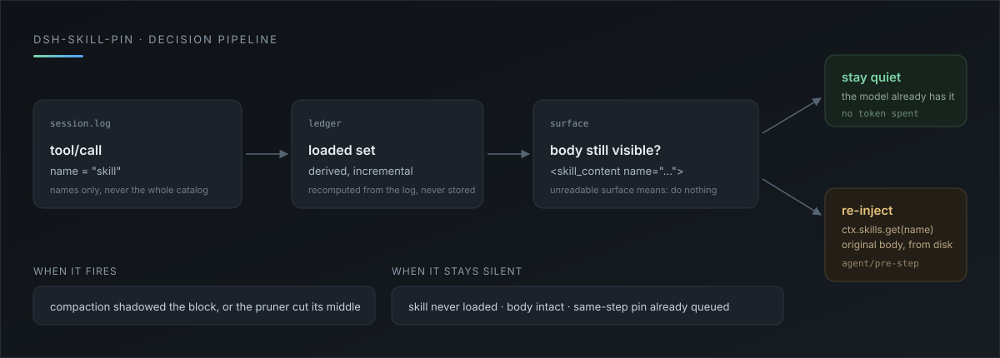

<p align="center">
  
</p>

<h1 align="center">dsh-skill-pin</h1>

<p align="center">
  Context compaction eats the skill instructions you already loaded.<br/>
  This plugin restores <strong>only the skills this session actually loaded</strong>, once their original text is gone.
</p>

<p align="center">
  <a href="LICENSE"></a>
  
  
  
</p>

<p align="center">
  
</p>

## The problem

A skill body is loaded once. `skill` turns `SKILL.md` into one ordinary tool result, and two mechanisms later erase it:

- **Context compaction** folds older history into a summary — the model keeps "I loaded unslop", but the rules and checklists are gone.
- **Tool-result pruning** cuts oversized results down to a head, a `middle pruned` marker, and a tail. A 30 KB skill body is squarely in range.

Nothing in the harness re-loads a skill after compaction, so the only fallback is the model remembering to call `skill` again — and it usually does not know it forgot.

## What it restores

No skill-directory scan, no preloading. Three steps:

| Step | Source | Result |
|---|---|---|
| 1. What did this session load? | `tool/call` events with `name = "skill"` in the session log | a set of skill names |
| 2. Is the body still visible? | `<skill_content name="…">` on the model-visible surface | `intact` / `pruned` / absent |
| 3. Restore? | loaded **and** not intact | re-read the original via `ctx.skills.get`, inject one user message |

The restored text is the original body read from disk, not the compaction summary. Summaries drift; files do not.

## When it acts

| State | Behaviour |
|---|---|
| No skill loaded this session | nothing |
| Loaded, body intact on the surface | nothing, zero tokens |
| Loaded, shadowed by compaction or cut by pruning | inject one user message tagged `source.kind = "skill-pin"` |
| A pin is already queued for this step | no duplicate |
| Surface unreadable | nothing — it never guesses |

The pin lands in the session log, so the next compaction can remove it and the plugin will pin it again.

## Install

```bash
git clone https://github.com/LBM-OASIG/dsh-skill-pin.git
dsh plugin --profile desktop add link:<absolute path to the clone>
```

Host-only: no client half, no settings page, no runtime dependencies.

## Configuration

Edit the row's `config` in the profile patch:

| Field | Default | Meaning |
|---|---|---|
| `enabled` | `true` | Master switch |
| `maxCharsPerSkill` | `20000` | Per-skill character cap; truncation is stated in the body |
| `maxTotalChars` | `40000` | Total character budget per restore |
| `maxSkills` | `5` | Skills restored in one step |
| `allowSkills` | `[]` | Only these names; empty means all |
| `denySkills` | `[]` | Never restore these names |

## How it differs from always-on file injection

Existing plugins can inject configured files into context on every session start and after each compaction. dsh-skill-pin is narrower:

| | Always-on file injection | dsh-skill-pin |
|---|---|---|
| Target | files fixed in config | skills this session loaded |
| Trigger | every new session / every compaction | only when the body was lost |
| Sessions that never needed it | still pay tokens | pay nothing |
| Content | the configured file | fresh `ctx.skills.get` from disk |

## Design constraints

- **The log is the only source of truth.** The loaded set and pins are derived from session events; plugin memory is a cache that is recomputed after a restart.
- **No new event types.** The pin is an ordinary user message with a plugin-owned `source.kind`; older readers still replay the session correctly.
- **No system-prompt writes.** Restores ride `agent/pre-step`, appear only when needed, and never repeat every turn.
- **Surface first.** The decision reads the model-visible surface, not raw log events: a shadowed result does not count as present.

## Verification

```bash
npm test
```

20 cases: incremental log scan (including a fork re-scan), the three surface states, same-step de-duplication, per-skill truncation, total budget, allow/deny, a skill the registry no longer knows, and the full round trip after a compaction removes a pin.

Also observed on a live harness: the row activates, the scan picks up the skill loaded in the real session log, and the plugin stays silent while the body is still visible.

Not yet exercised live: an automatic restore triggered by a real compaction or pruning, which needs a session large enough to compact and a sufficiently large skill body.

## Development

Editing `index.js` requires reloading the row (no hot reload):

```bash
plugin_manager set_plugin target=include:dsh-skill-pin enabled=false
plugin_manager set_plugin target=include:dsh-skill-pin enabled=true
```

## License

MIT. Community plugin, not affiliated with DeepSeek.
