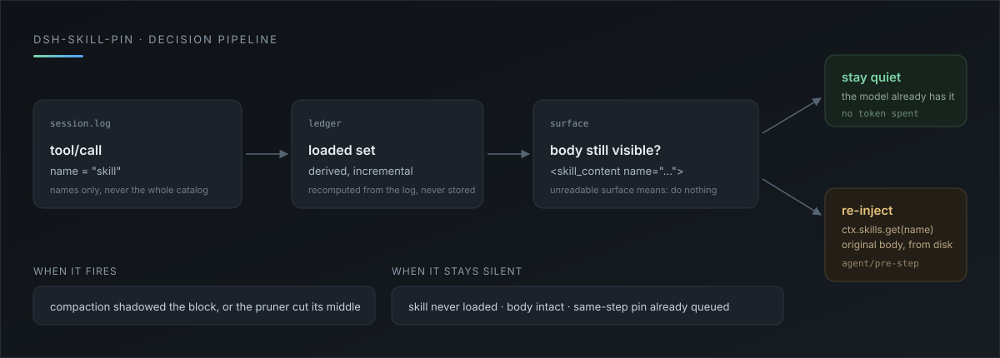

<p align="center">
  
</p>

<h1 align="center">dsh-skill-pin</h1>

<p align="center">
  上下文压缩会吃掉已经加载的 skill 正文。<br/>
  这个插件把<strong>这次会话真正调用过</strong>的那几个 skill，在原版被挤掉之后自动补回来。
</p>

<p align="center">
  <a href="LICENSE"></a>
  
  
  
</p>

<p align="center">
  
</p>

## 问题

skill 的正文是一次性加载的：`skill` 工具把 `SKILL.md` 读进对话，之后就只是一条普通工具结果。

于是两件事会把它抹掉：

- **上下文压缩**：较早的历史被折成一条摘要，模型只剩摘要里那句「加载过 unslop」，红线规则和检查清单全没了；
- **工具结果修剪**：超过阈值的工具输出被砍成「头 + middle pruned + 尾」，30KB 的技能正文正好在射程内。

官方没有任何「压缩后把 skill 补回来」的机制，只能靠模型自觉重新调一次 `skill`——而模型往往并不知道自己已经忘了。

## 它只补加载过的

插件不扫技能目录，也不预载任何 skill。判定链是三段：

| 步骤 | 数据来源 | 得到什么 |
|---|---|---|
| 1. 这次会话加载过什么 | 会话日志里的 `tool/call` 事件，`name = "skill"` | 一组 skill 名字 |
| 2. 正文现在还看得见吗 | 模型可见层里有没有 `<skill_content name="…">` | `intact` / `pruned` / 缺失 |
| 3. 要不要补 | 1 有名字、2 又不是 `intact` | 用 `ctx.skills.get` 重新读磁盘原版，补一条用户消息 |

补出来的内容不是压缩摘要，是**重新从磁盘读的原版正文**——摘要会失真，原文不会。

## 什么时候动手

| 状态 | 插件行为 |
|---|---|
| 本轮从没加载过 skill | 什么都不做 |
| 加载过，正文完整在可见层 | 什么都不做，不花 token |
| 加载过，但被压缩遮蔽 / 被修剪砍断 | 注入一条带 `source.kind = "skill-pin"` 的用户消息 |
| 同一步已经排进一条钉子 | 不重复注入 |
| 可见层读不出来 | 不动手，绝不靠猜 |

注入的消息会落进会话日志，所以下一次压缩把它吃掉之后，还能再补——钉子可以被反复钉。

## 安装

```bash
git clone https://github.com/LBM-OASIG/dsh-skill-pin.git
dsh plugin --profile desktop add link:<克隆出来的绝对路径>
```

装完在 profile 的 `cordis.patch.yml` 里能找到这一行：

```yaml
- id: dsh-skill-pin
  name: 'dsh-skill-pin'
  config: {}
```

这是一个**纯宿主插件**：没有客户端一半，没有设置页，没有运行时依赖。

## 配置

改上面那行的 `config` 即可，字段都是可选的：

| 字段 | 默认值 | 含义 |
|---|---|---|
| `enabled` | `true` | 总开关 |
| `maxCharsPerSkill` | `20000` | 单个 skill 重注正文的字符上限，超出截断并在正文里注明 |
| `maxTotalChars` | `40000` | 一次重注的总字符预算，超出的 skill 跳过 |
| `maxSkills` | `5` | 一次最多重注几个 skill |
| `allowSkills` | `[]` | 只保活这些名字；空数组表示全部 |
| `denySkills` | `[]` | 永不保活这些名字 |

例：只在 `unslop` 上生效，并把单个上限压到 16k：

```yaml
- id: dsh-skill-pin
  name: 'dsh-skill-pin'
  config:
    allowSkills: ['unslop']
    maxCharsPerSkill: 16000
```

## 和「把文件塞进上下文」有什么不一样

社区里已有把文件常驻注入的插件（例如 `@path` 导入那类）。差别在**触发条件**：

| | 常驻注入插件 | dsh-skill-pin |
|---|---|---|
| 注入对象 | 配置里写死的文件 | 本次会话真正加载过的 skill |
| 注入时机 | 每个新会话 / 每次压缩后 | 只在正文被压缩或修剪弄丢时 |
| 没用到该 skill 的会话 | 照样付 token | 一分不花 |
| 内容来源 | 配置文件 | `ctx.skills.get` 现读磁盘 |

一句话：一个是「我让你一直记着」，一个是「你用过，我就帮你记着」。

## 设计约束

- **日志是唯一事实**：加载过哪些 skill、补过几次，全部从会话日志推导；插件自己的状态只是缓存，进程重启后重新算。
- **不新增事件类型**：注入用的是普通用户消息，`source.kind` 是插件自有标签，旧读取器不认识也不影响回放。
- **不碰系统提示词**：正文走 `agent/pre-step` 的消息批次，只在需要时出现，不会每轮重发。
- **可见层优先**：判定看模型真正会看到的那一层，而不是日志里的原始事件——被压缩遮蔽的结果不算「还在」。

## 验证

```bash
npm test
```

23 例，覆盖：日志增量扫描（含 fork 后重扫）、可见层三态、同一步去重、单技能截断、总预算、allow/deny、注册表里已不存在的 skill、「压缩吞掉钉子后再次补注」的完整往返，以及服务访问的回归（未声明的 Cordis 服务一律不碰、`workingDirectory` 不可用时回退会话 cwd、注册表抛错也不让本轮失败）。

真机试过的部分：

- 装载后 `fiberPhase: active`；
- 拿真实会话日志跑扫描，正确认出本会话加载过的 skill；
- 正文仍在可见层时插件保持沉默（日志里 0 条 pin），符合设计。

尚未在真机触发的一步：**由真实压缩/修剪引发的自动补注**。要复现，需要一个长到触发压缩的会话，并且加载过一篇足够大的 skill（阈值默认 8192 字符）。

## 开发

改 `index.js` 不会热更，重载这一行才会重新 import：

```bash
plugin_manager set_plugin target=include:dsh-skill-pin enabled=false
plugin_manager set_plugin target=include:dsh-skill-pin enabled=true
```

目录结构：

```
index.js            插件本体（零依赖）
cordis.patch.yml    bundle 的插入行
locale/{en,zh}.json 插件面板里的标题与描述
icon.svg            图标
assets/pipeline.svg 流程图
test/unit.test.mjs  23 例单元测试
```

## License

MIT。本项目是社区插件，与 DeepSeek 官方无关。
